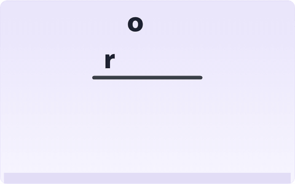

# romp

[](https://github.com/isaacrowntree/romp/actions)
[](LICENSE)
[](https://isaacrowntree.com/romp/)

**Physics-baked character motion, a motion check and synthesised sound for videos made in code.** Works with Remotion, three.js or any page with a `seek(t)`, played live on `requestAnimationFrame` or rendered frame by frame.

### ▶ [Docs and live demo](https://isaacrowntree.com/romp/)

[](https://isaacrowntree.com/romp/)

*Every frame above was read from one simulation baked at 240 Hz. The letters are springy bodies welded where they land, so the p wobbles back after the knock; each character's squash, blink and hat follow-through (`jiggleParts`) are sized by the real speed of its own impacts. On the [live demo](https://isaacrowntree.com/romp/) you can play it with sound on the audio clock, scrub, render the same soundtrack offline to a WAV, and run the motion check, then plant a bug and watch it fail.*

## Why

Videos made in code (product promos, app previews, explainers) tend to fail the same way: linear easing, things that pop in at full size, motion that kinks where two moves meet, and silence, or a stock track that ignores the picture. Keyframing your way out of that is slow, and you can't see a pop at 30 fps until a viewer does.

romp encodes the fixes as a small library:

- **Choreography says where and when; physics says how.** Anything that falls, piles, gets knocked or hops is a rigid body in a planck.js (Box2D) world, not an eased arc.
- **Bake once, read every frame.** A scene is simulated once at a fixed 240 Hz and one pose per frame is stored. Reading a pose is a pure function of time, so the same motion plays in a live viewer, a frame-by-frame renderer, a scrubber and the motion check, identically.
- **Impacts drive the picture and the sound.** Every landing is recorded with its speed. Squash, closed eyes, follow-through on hats and antennae, and the boing on the soundtrack all hang off the same impact.
- **A motion check you can run in CI.** It steps every frame and flags **pops** (appears or vanishes at full size, opaque), **strobes** (more than ~100 px in one frame at 886 px wide), **teleports** (more than ~300 px), **spikes** (a kink in the motion), **lost** (a character that leaves the frame and stays out) and **crops** (more than a quarter of it outside the frame for more than half a second, other than while entering or leaving), with exemptions for real impacts, deliberate whips, covered frames, fades and objects you allow to crop.
- **Sound that belongs to the picture.** Synthesised voices (marimba, bell, plucks, Rhodes, upright, kit, whooshes, plops, boings, gibberish character voices), a mix tuned for phone speakers, and one schedule function that plays live or renders offline. No samples, so there's nothing to license. The same schedule is also a **signal** the picture can react to (`listen()`: envelopes, beats, onsets), with no live analyser.
- **Particles that render frame by frame.** Confetti, sparks, snow and fountains from a seeded emitter whose every particle is a pure function of the frame, so they work in Remotion (where real-time particle libraries can't).
- **Bring your own timeline.** Adapters for Theatre.js and Motion Canvas, and the motion check for Lottie (After Effects) exports.

## Install

Not on npm yet: install it from GitHub.

```bash
bun add github:isaacrowntree/romp planck
# for the CLI, also: bun add -d esbuild playwright
```

The adapters (`romp/three`, `romp/remotion`, `romp/theatre`, `romp/motion-canvas`, `romp/lottie`) work with libraries you already use; they're optional peer dependencies, so core users install none of them.

## Usage

### Physics: bake a scene, read poses

```ts
import { Stage, Body, poseAt, impactResponse, nearImpact } from "romp/core";

const stage = new Stage(); // screen space (y down); new Stage({ yDown: false }) for three.js
stage.ground([{ x: 40, y: 200 }, { x: 40, y: 1830 }, { x: 1040, y: 1830 }, { x: 1040, y: 200 }]);
stage.add(new Body({ id: "hero", x: 540, y: -100, w: 150, h: 150, spawn: 10, vy: 900, spin: 0.3 }));
stage.bake({ frames: 200, fps: 30 }); // once

const hero = stage.get<Body>("hero");
const pose = poseAt(hero, frame);              // { shown, x, y, angle }, interpolated
const look = impactResponse(hero, frame);       // { squashX, squashY, tilt, lift, blink, jiggle }
```

`SpringyBody` welds to its ground where it lands (a letter that can be knocked over and wobbles back). `Drop` is a dropped prop: a contact foot, a gravity scale, spin and tilt that unwind to zero at touchdown, depth drift arrested on contact, a rock direction, and its own ledge drawn in its parent's frame (`flight()`, `framePose()`); `Leap` is a ballistic leap through a surface. Your own actors implement `build`, `control`, `sample` and optionally `apply(pose, t)`: `stage.pose(t)` calls every `apply`, and `poseAt(actor, frame, { discrete: "previous" })` holds booleans until the next frame when you need to match an existing renderer. Collision layers (`LAYER`) keep a pile of characters from landing on a wordmark. Without physics, `landing()`, `hop()`, `idle()`, `blinkAt()` and `boing()` give the same squash-and-stretch vocabulary as pure functions of the frame; `ease`, `spring()` and `ringOut()` are closed-form curves.

### Two ways to play: live, or frame by frame

**Live** (a viewer page): the `Clock` drives your `seek(t)` on `requestAnimationFrame`. While sound plays the picture follows the **audio clock**, so they can't drift.

```ts
import { Clock } from "romp/core";
import { playLive } from "romp/audio";
import { cartoon } from "romp/audio/cartoon";

const audio = new AudioContext();
let live;
const clock = new Clock({
  seek, duration: 6, audio,
  onPlay: async (t) => { live = await playLive(audio, schedule, { from: t, extend: cartoon }); },
  onStop: () => live?.stop(),
});
button.onclick = () => (clock.playing ? clock.pause() : clock.play());
```

**Offline** (Remotion, or a seek(t) page captured to MP4): read poses by frame, and render the same schedule to a WAV.

```ts
import { renderWav } from "romp/audio";
export const render = () => renderWav(schedule, { duration: 6, extend: cartoon }); // `romp sound` runs this
```

In Remotion, read by frame: `poseAt(body, useCurrentFrame())`.

### Sound: one schedule, written once

```ts
import { Instruments, type Schedule } from "romp/audio";

export const schedule: Schedule = (s, bus, at) => {
  const band = new Instruments(s);                        // pluck, kick, shaker, rhodes, piano, upright, rim, brush
  for (let b = 0; b < 12; b++) {
    const t = at(b * 0.5); if (t == null) continue;        // at(): film time → context time (null = already played)
    band.kick(t, bus.drums);
    s.marimba(t, 74 + (b % 5) * 2, bus.music, { vel: 0.15 });
  }
  for (const hit of hero.impacts) {
    const t = at(hit.t); if (t != null) s.boing(t - 1 / 30, bus.sfx, { k: hit.speed / 900 }); // transients lead by a frame
  }
};
```

The mix (`createMix`) has music, drums, sfx and voice buses with a shared room, a 70 Hz high-pass, a low shelf and a glue compressor. `romp/audio/cartoon` adds `plop`, `boing`, `babble` (gibberish voices: `hero`, `squeaky`, `low`, `sleepy`, …, or your own `{ f0, swing, rate }`), `slurp`, `beep`, `ding`, `tock`, `pip`, `swish` and `scribble`. Set `s.harmony = (t) => pitchClassSet` and every tonal effect fits the chord sounding at that moment.

The rules worth keeping: **restraint** (only each beat's focal event gets a sound), **one family** (tonal effects on one voice, in the score's key), **transients lead the picture by about a frame**, **no identical repeats** (every voice takes a seed), and **keep the energy in 200 Hz–6 kHz** so it survives a phone speaker.

### Sound as a signal

`listen(schedule)` runs your schedule once, silently, and records every voice it plays. The score it returns answers in film seconds, as pure functions of t, so a pulse on the kick looks the same live, rendered and in the motion check:

```ts
import { listen } from "romp/audio";
import { cartoon } from "romp/audio/cartoon";

const score = listen(schedule, { extend: cartoon });
score.envelopeAt(t, { voice: "kick", decay: 0.25 }); // how loud the kicks are at t (sum of each hit's level)
score.envelopeAt(t, { bus: "music" });               // anything on a bus
score.beatAt(t);                                     // { index, phase 0→1, since } between drum onsets
score.onsetsBetween(t - 1 / 30, t, { bus: "sfx" });  // what started this frame
```

Events carry `{ t, end, voice, bus, vel, midi?, shape }`: a hit attacks and decays over its voice's ring, a swell (`whoosh`, `riser`) rises to its peak, a bed (`crackle`, `surf`) holds. Times are as scheduled, so transients still lead the picture by a frame.

### Particles

```ts
import { Emitter, confetti, sparks, snow, fountain, particleStyle } from "romp/particles";

const burst = new Emitter(confetti({ x: 540, y: 900, at: 45, seed: 3, ground: 1830 }));
const ps = burst.particlesAt(frame); // [{ i, x, y, angle, size, length, flip, opacity, color, shape, … }]
ps.map((p) => <i key={p.i} style={particleStyle(p)} />);   // or drawParticles(ctx, ps) on a canvas
```

Every particle's launch comes from a seeded hash of its index and its flight is closed-form (gravity, wind, linear drag, sway, spin, confetti flip), so any frame can be read in any order. `ground` takes a y or the polyline you gave `stage.ground()`; particles bounce and come to rest on it. Presets are plain options to spread and override: `confetti`, `sparks` (streaks that face their motion), `snow` (a stream from above the frame) and `fountain`.

**The motion check and particles.** Particles grow in (`grow`, 0.08 s) and fade out (`fadeOut`, 0.3 s) by default, so even tracked one by one they aren't pops. Fast sparks are strobes by design, so don't track single particles: track the burst as one object, `trackBurst(name, ps)` from `romp/remotion` (an empty element covering the burst, centred where it comes from) or `particleSample(ps)` for your own collector. Untracked elements are never checked.

### The motion check

**Remotion / DOM:** mark what to follow, then run the CLI.

```tsx
import { track } from "romp/remotion";
<div {...track("hero", { impact: nearImpact(hero.impacts, frame) })} style={…} />
```

```ts
// check.tsx
import { MyVideo } from "./MyVideo";
export default { component: MyVideo, durationInFrames: 1500, fps: 30, width: 1080, height: 1920, covered: [[4.2, 4.9]] };
```

```bash
bunx romp check check.tsx --public public   # exit 1 on issues; --json for machines
```

**three.js:** name your objects, then

```ts
import { motionReport } from "romp/three";
const { issues } = motionReport({ seek, scene, camera, fps: 30, W: 886, H: 1920, from: 0, to: 30, whips, covered });
```

**Lottie (After Effects exports):** every layer, every frame, through lottie-web's own transforms (parents and precomps included).

```ts
import { lottieReport, formatReport } from "romp/lottie";
const anim = lottie.loadAnimation({ container, renderer: "svg", autoplay: false, animationData });
console.log(formatReport(lottieReport(anim), anim.frameRate)); // a layer cut in at full size is a pop
```

```bash
bunx romp check --lottie anim.json [--layers ball,badge]   # needs lottie-web in your project
```

**Theatre.js:** a sequence's `position` is film seconds, so it can host romp's baked motion and the check can step it.

```ts
import { onChange } from "@theatre/core";
import { followSequence, seekSequence, theatreReport, objectsRow } from "romp/theatre";

followSequence(sheet.sequence, onChange, (t) => stage.pose(t));     // Theatre's playhead drives romp
const seek = seekSequence(sheet.sequence, (t) => stage.pose(t));      // or romp (Clock, a frame) drives Theatre
const report = theatreReport({ sequence: sheet.sequence, to: 6, fps: 30, width: 1920, height: 1080, collect: () => objectsRow(objects) });
```

**Motion Canvas:** play baked poses inside a scene by its time, and check a project's nodes.

```ts
import { playBaked, centred, motionCanvasReport, byKey } from "romp/motion-canvas";
yield* playBaked((t) => { const p = centred(poseAtTime(body, t), 1920, 1080); hero.position(p.position); hero.rotation(p.rotation); }, { duration: 6, time: useTime });

const report = await motionCanvasReport({ seek: (f) => player.playback.seek(f), nodes: () => byKey(player.playback.currentScene.getView(), ["hero"]), fps: 30, width: 1920, height: 1080, to: 6 });
```

**Anything else:** build `{ f, row: { name: { x, y, shown, onScreen, area, opacity, box? } } }` per frame and call `analyze(frames, { fps, width, height })` from `romp/check` (the cropped and lost checks need `box`, `width` and `height`).

### CLI

```bash
romp check <entry.tsx> [--public dir] [--from s] [--to s] [--arg json] [--json]
romp check --lottie <anim.json> [--layers a,b] [--from s] [--to s] [--json]
romp sound <module.ts> --out file.wav [--arg json] [--lufs -16]
```

`romp sound` bundles a module exporting `render(arg)` (an `AudioBuffer` or a base64 WAV), renders it in headless Chromium and loudness-normalises it with ffmpeg when it's on your PATH.

## Entry points

| Import | What |
|---|---|
| `romp/core` | `Stage` (`add`, `bake`, `pose`, `get`), `Body`, `SpringyBody`, `Drop`, `Leap`, `LAYER`, `poseAt`, `poseAtTime`, `baked`; `impactResponse`, `landing`, `hop`, `idle`, `blinkAt`, `boing`, `jiggle`, `jiggleParts`, `rock`, `nearImpact`; `ease`, `spring`, `ringOut`, `stagger`; `Clock` |
| `romp/check` | `analyze`, `formatReport`, `collectDom`, `inFrameShare` |
| `romp/remotion` | `track`, `trackBurst`, `collectDom`, `analyze` |
| `romp/three` | `motionReport`, `screenBox`, `screenArea`, `opacityOf` |
| `romp/audio` | `Synth`, `Instruments`, `createMix`, `renderOffline`, `renderWav`, `playLive`, `listen`, `Score`, `fitTo`, `wavBase64`, `LEAD` |
| `romp/audio/cartoon` | `cartoon`, `VOICES` |
| `romp/particles` | `Emitter`, `particlesAt`, `confetti`, `sparks`, `snow`, `fountain`, `particleStyle`, `drawParticles`, `particleBox`, `particleBounds`, `particleSample`, `hash01` |
| `romp/theatre` | `seekSequence`, `followSequence`, `objectSample`, `objectsRow`, `theatreFrames`, `theatreReport` |
| `romp/motion-canvas` | `playBaked`, `centred`, `byKey`, `nodeSample`, `nodesRow`, `motionCanvasReport` |
| `romp/lottie` | `collectLottie`, `lottieFrames`, `lottieReport` |

## License

MIT © Isaac Rowntree
